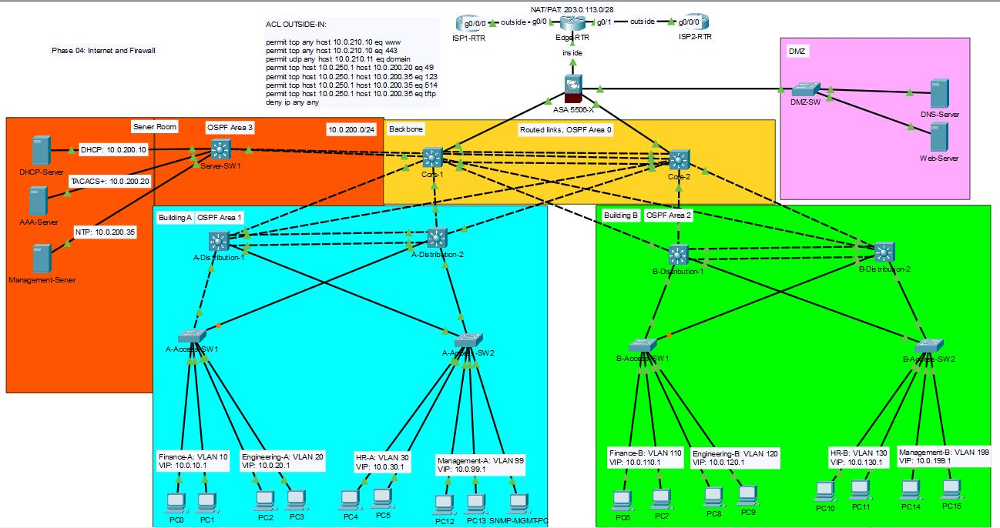

## TNARC HQ: Internet Edge and Perimeter Firewall

## The Problem
TNARC's HQ has no internet connection yet. Staff need web access, and clients need to reach a public website and DNS hosted by TNARC. Additionally, As a financial company, TNARC cannot rely on a single provider. One ISP outage takes the business offline. Public facing servers must never become a path to the internal network. Leadership wants the perimeter secured before any branch connects.

## Requirements
1. Users reach an "internet" test server through either ISP.
2. If the primary ISP fails, traffic fails over automatically, and fails back when it recovers.
3. Internal addresses never appear on the internet side, configure NAT or PAT.
4. TNARC's public address block is reachable through both ISPs.
5. Internet users can reach the DMZ web and DNS servers, and nothing else.
6. DMZ servers can't start connections to the inside network.
7. Every allowed and denied flow is documented in a traffic-flow matrix and tested.
8. New edge devices follow the Stage 2 and Stage 3 baselines.

## Topology Changes
| Device | Model | Role | Connects to |
|--------|-------|------|-------------|
| ISP1-RTR | ISR 4331 | Simulated Internet Service Provider 1 | Edge-RTR |
| ISP2-RTR | ISR 4331 | Simulated Internet Service Provider 2 | Edge-RTR |
| Edge-RTR | 2911 | eBGP to both ISPs | ISP1, ISP2, ASA outside | 
| ASA | 5506-X | Perimeter firewall | Edge-RTR, Core-1, Core-2, DMZ-SW |
| DMZ-SW | 2960 | | ASA |

## Network Addressing

| Device | Port | | Device | Port | Subnet | Autonomous System |
|--------|------|-|--------|------|--------|-------------------|
| ISP1-RTR | g0/0/0 | -> | Edge-RTR | g0/0 | 198.51.100.0/30 | 65001 |
| ISP2-RTR | g0/0/0 | -> | Edge-RTR | g0/1 | 198.51.100.4/30 | 65002 |
| Edge-RTR | g0/0 | -> | ISP1-RTR | g0/0/0 | 198.51.100.0/30 | 65100 |
| Edge-RTR | g0/1 | -> | ISP2-RTR | g0/0/0 | 198.51.100.4/30 | 65100 |
| Edge-RTR | g0/2 | -> | ASA 5506 | g1/1 | 10.0.250.0/30 |
| ASA 5506 | g1/1 | -> | Edge-RTR | g0/2 | 10.0.250.0/30 |
| ASA 5506 | g1/2 | -> | Core-1 | g1/0/7 | 10.0.255.60/30 |
| ASA 5506 | g1/3 | -> | Core-2 | g1/0/7 | 10.0.255.56/30 |
| Asa 5506 | g1/4 | -> | DMZ-SW | g1/0/1 | 10.0.240.0/240 |

## Traffic-Flow Matrix
| # | Source | Destination | Service | Expected | Result |
|---|--------|-------------|---------|----------|--------|
| 1 | Inside Users | Internet | Web (HTTP/HTTPS) | Allow | |
| 2 | Inside Users | DMZ Web-SRV | HTTP/HTTPS | Allow | |
| 3 | Internet | Web-SRV (public IP) | HTTP/HTTPS | Allow | |
| 4 | Internet | DNS-Pub | DNS | Allow | |
| 5 | Internet | Inside | Anything | Deny | |
| 6 | DMZ | Inside | Anything | Deny | |
| 7 | Management VLAN | ASA/Edge-RTR | SSH | Allow | |
| 8 | Anyone else | ASA/Edge-RTR | SSH | Deny | |
| 9 | Edge-RTR | AAA-Server | TCP 49 (TACACS+) | Allow | |
| 10 | Edge-RTR | Syslog/NTP/TFTP | UDP 514/123/69 | Allow | |
| 11 | Edge-RTR | Inside hosts | ICMP echo | Deny | |
| 12 | DMZ-SW | AAA-Server | TCP 49 | Deny | |
| 13 | DMZ-Server | Inside | Anything | Deny | |

## Key Decisions
1. NAT runs on the Edge-RTR, not the ASA. Packet Tracer's ASA only supports PAT to its own interface address. Its outside interface uses a private transit address, which cannot be used for internet traffic. With NAT on Edge-RTR, the ASA becomes purely a policy device, its rules and logs see real internet addresses. 
      - In a real world scenario, NAT would be on the firewall to keep translation and policy on the same device.

2. TNARC owns its public block (203.0.113.0/28) and advertises it to both ISPs over eBGP. Users are transalated to addresses in that block rather than ISP assigned ones, this allows for replies to return through either provider. A null route for the /28 lets BGP advertise the full block, while the more specific routes still carry actual traffic.

3. BGP AD on ISP1's routes are static default, while on ISP2 they have an AD of 150. 

4. Core-1 and Core-2 each have a static default route to the ASA's inside interface and share it into OSPF with "default-information originate", every building learns one default route. The ASA can't run OSPF in packet tracer, so it used static routes. A default route to Edge-RTR and a route back to 10.0.0.0/16 through the core.

5. The /28 is split by purpose: 203.0.113.1-.10 is the PAT pool for users, .11 and .12 are static NAT for DMZ web and DNS servers. The remaining addresses are kept as spare. Keeping the PAT pool separate from static range means user traffic can never take a public address assigned to a server.

6. ASA zones and rules: Inside=100, DMZ=50, Outside=0. Inside -> DMZ and Inside -> Outside rely on the security-level defaults and stateful return traffic. Anything starting from a lower security zone needs an explicit permit in ACL "OUTSIDE-IN". Each ACL ends with deny ip any any, ICMP replies are handled by inspect icmp/echo reply rules.

7. Edge-RTR sits outside the firewall, it can reach AAA-server (TACACS, Syslog, NTP, TFTP) through narrow host-to-host rules in ACL "OUTSIDE-IN". It can't start any other connection to the inside, including pings. If the router was every compromised, the internal network still couldn't be mapped.

8. DMZ-SW uses local accounts instead of TACACS+. Allowing DMZ -> TACACS+ traffic would let a compromised DMZ device use its TACACS+ key to guess central credentials, or attack teh server that controls access to the whole network. DMZ switch is managed only by senior admins, each with an individual account (admin1: CiscoTNARC1 , admin2: CiscoTNARC2). Logins stay individually accountable.

## Verification

## Challenges and Fixes
#### 1. ISR 4331 had too few ports for Edge-RTR
 - Edge-RTR needed three routed interfaces (ISP1, ISP2, ASA), but 4331 has only two onboardm and its NIM switch-module ports are Layer 2.
 - Fix: Replaced the 4331 with a 2911, has 3 routed Gigabit ports.

#### 2. The ASA wouldn't PAT to a public address
 - NAT (inside1 / outside) dynamic PAT-ADDRESSES was being rejected, only dynamic interface was accepted.
 - Packet Tracer only supports PAT to interface addresses on the ASA, this would give the outside interface a private address.
 - Fix: Moved NAT/PAT to Edge-RTR
 - No intrusion detection or next-generation firewall features (IPS, URL filtering, TLS inspection).
 - DMZ-SW's local accounts must be removed by hand during offboarding.

## Limitations
- Packet Tracer supports eBGP but not iBGP, so a redundant second edge router running iBGP isn't possible.
- Edge-RTR and the ASA are single points of failure; production would use HA pairs.
- Packet Tracer's ASA only supports PAT to its interface address, which is why NAT runs on Edge-RTR.

## What I'd Do Next
1. Stage 5: connect Branch 1 and the acquired Branch 2 (Lab 02), deployed with every baseline so far.
2. A VPN backup path for a branch over the internet edge (Lab 04).
3. In production: HA pairs for the edge router and firewall, and out-of-band management.

