# Temporarily using test environment
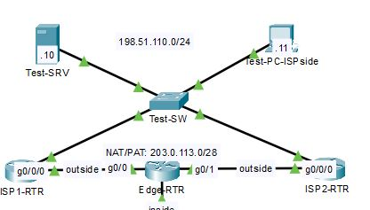

## 1

## 2

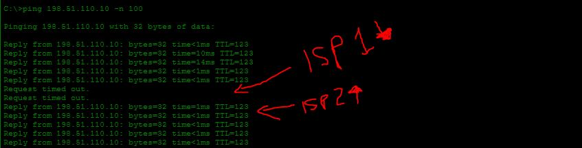
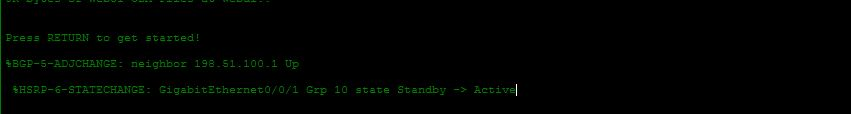
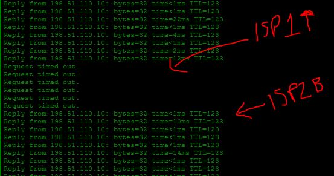
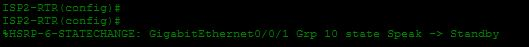

## 3
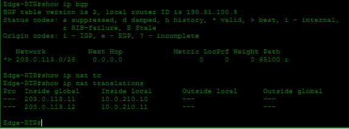

## 4
##### Before PAT translation
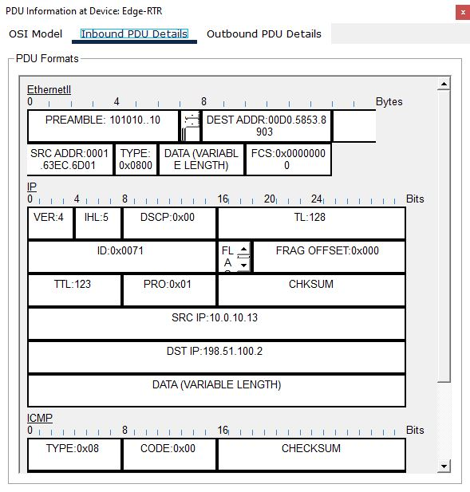

##### After PAT translation

## 5
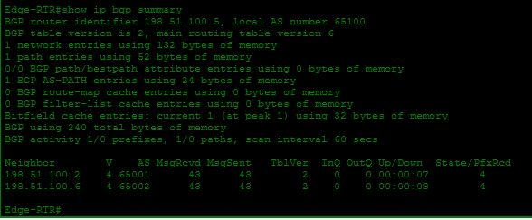
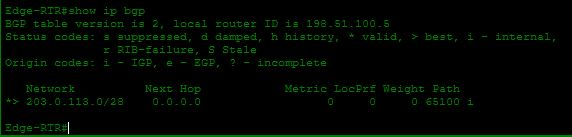
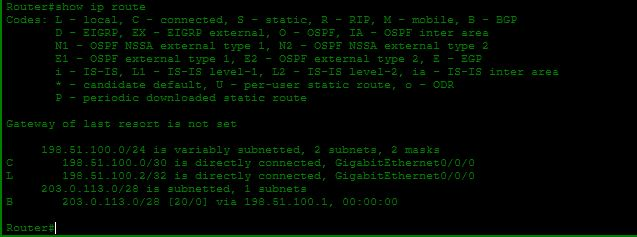
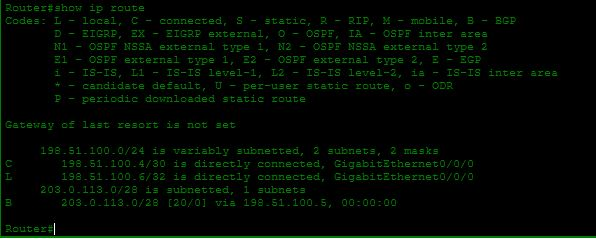

## 6
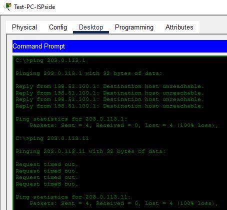

## 7

## 8
##### Web-server pinging inside
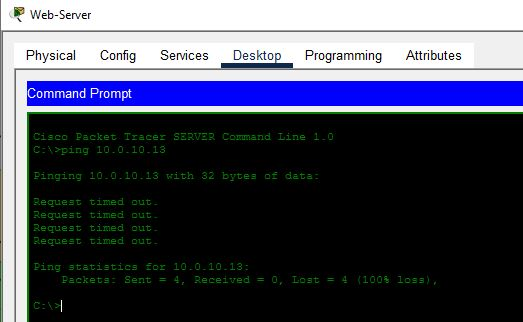

##### DMZ telnet inside
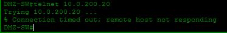

## 9

## 10
##### SSH'd into Edge-RTR via Management VLAN PC, using TNARCadmin01:admin123
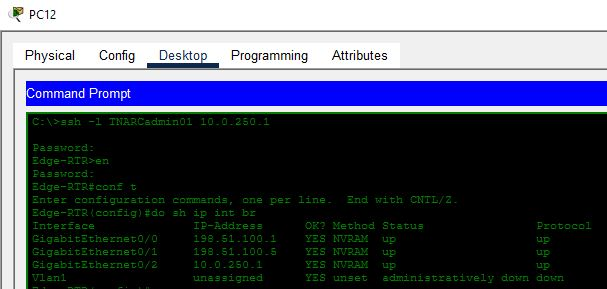

##### Syslog Alert about login
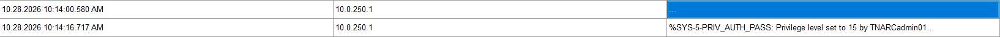

##### Ping to an Internal Network user PC failed as intended
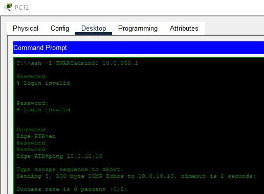

## 11
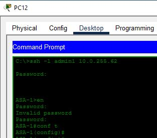

## 12
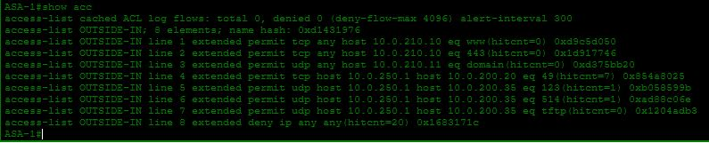